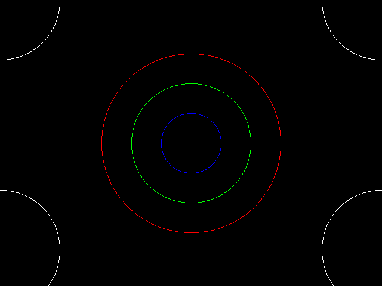
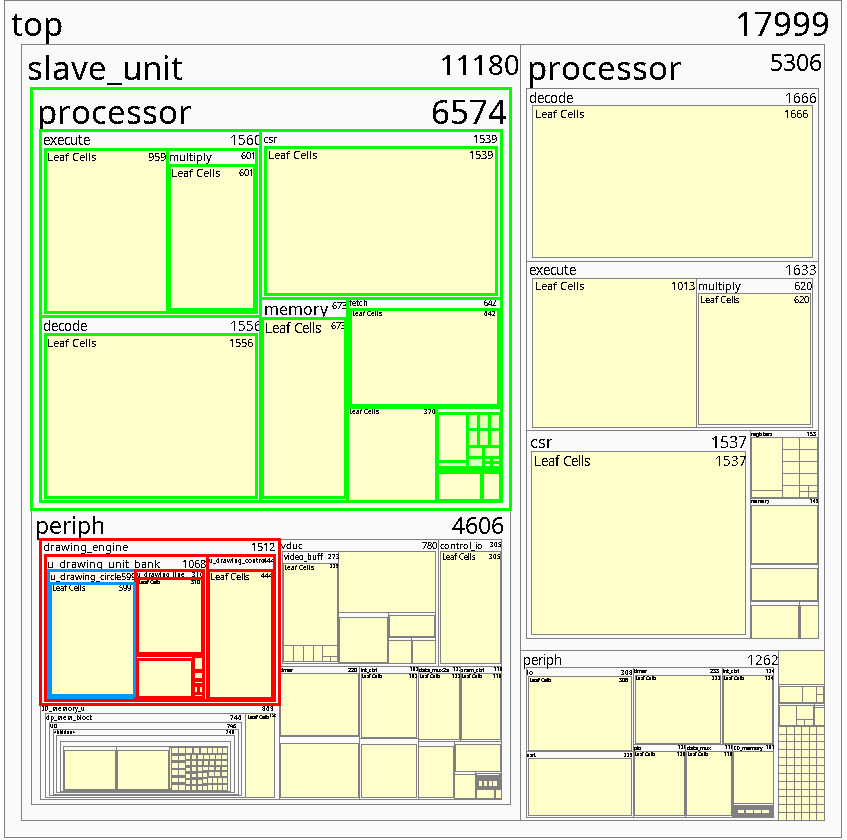
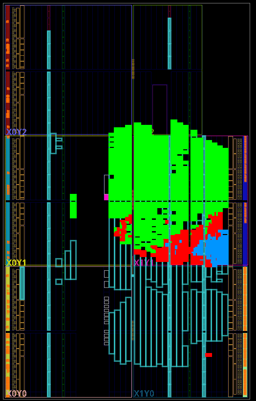

# drawing-accelerator

Hardware circle-drawing unit for a memory-mapped 2D drawing accelerator. It runs inside a RISC-V system-on-chip on an FPGA. The unit is written in SystemVerilog, verified in simulation (Questa) against a C++ golden model, then synthesised into the full SoC (Vivado) and driven by RISC-V assembly programs.

University of Manchester coursework (COMP32211). The course staff (J. Garside, A. Mathews) provided the surrounding drawing-engine infrastructure. That covers the bus interface, the register file and control, unit mux/demux, the line and clear units, the mock framestore and SRAM, and the original C++ model. **My work** is listed below.



## What I built

### 1. Circle drawing unit: [`src/COMP32211/circle.sv`](src/COMP32211/circle.sv)

A hardware **midpoint circle** rasteriser that plugs into slot 2 of the drawing engine's unit bank.

- **Interface:** a `req`/`ack` command handshake reads centre (R0, R1), radius (R4) and 8-bit colour (R6). Pixels are written through the framestore's `de_req`/`de_ack` bus as 32-bit words with active-low byte enables.
- **4-state FSM** (`IDLE → INIT → PLOT ⇄ CALC`):
  - `PLOT` walks the 8 symmetric octant points for the current `(x, y)`, issuing one memory write per point.
  - `CALC` advances the error term with shifts and adds only (no multipliers).
- **Per-pixel clipping:** off-screen points are skipped without starting a bus transaction. Circles that cross or lie entirely outside the 640×480 screen draw correctly and lose no cycles on clipped points.
- **Address generation:** `y × 640 + x` is computed as `(y << 9) + (y << 7) + x`. The low two address bits select the byte lane.
- **Integration:** wired into `drawing_unit_bank.sv` in place of a dummy unit.
- **Synthesised cost:** about 600 leaf cells, out of about 1,500 for the whole drawing engine and about 18,000 for the complete SoC.

### 2. Self-checking unit testbench: [`src/Phase_1/unit_Testbench.sv`](src/Phase_1/unit_Testbench.sv) + [`run_tests.py`](run_tests.py)

A reusable verification environment for any drawing unit with the standard interface. I used it first to find bugs in five black-box line units supplied by the staff (see [findings](docs/phase1_verification_findings.md)), then to verify my circle unit.

- **Golden-model comparison:** `run_tests.py` sends the test commands to the C++ model and turns its byte-addressed pixel output into word address, byte-enable and data triples. It then runs `vsim` with the commands and expected writes as plusargs. The testbench checks every framestore write.
- **Randomised back-pressure:** `de_ack` is delayed by a random number of cycles to exercise the memory handshake.
- **SystemVerilog assertions** for bus protocol rules:
  - no `ack` without `req`;
  - `ack` is a one-cycle pulse and is only raised while `busy`;
  - address, data and byte enables stay stable while a write is pending;
  - writes happen only while busy and only to valid addresses;
  - at least one byte lane is enabled on every write.
- A **mid-operation reset** test.
- Circle tests cover the screen centre, odd centres and radii, very small and very large radii, clipping at every edge and corner, and fully off-screen circles.

### 3. C++ reference model: [`models/circle.cpp`](models/circle.cpp)

The circle model in the provided C++ model was extended to clip pixels to the screen. Its pixel stream then matches the hardware's exactly, so it can serve as the golden reference.

### 4. System-level simulation: [`src/Phase_3/drawing_Testbench.sv`](src/Phase_3/drawing_Testbench.sv)

The top-level drawing-engine testbench was extended with a `draw_circle` bus task. It drives the full engine through its memory-mapped registers: concentric circles, then corner-clipped circles, rendered to a virtual screen (image above).

### 5. FPGA bring-up: [`src/Phase_4/`](src/Phase_4/)

RISC-V assembly programs that run on the SoC's processor and drive the accelerator through its memory-mapped registers (base `0x10800`). Each program clears the screen, writes the circle arguments, issues the command, then polls and clears the *done* bit in the status register.

- `program.s`: concentric RGB circles and a corner-clipping check.
- `circles.s`: an animated sweep of radii from 1 to 320 with cycling colours.

<p>
  
  
</p>

## Repository layout

```text
src/
├── COMP32211/      # Drawing engine RTL (staff) + circle.sv (mine)
├── GLIB/           # Xilinx glbl.v for simulation
├── Phase_1/        # Self-checking unit testbench (mine)
├── Phase_3/        # System-level drawing engine testbench (extended)
└── Phase_4/        # RISC-V assembly drivers (mine)
models/             # C++ algorithmic golden model (circle clipping added)
run_tests.py        # Golden-model-driven regression runner for the unit testbench
wave.do             # Questa waveform setup
docs/               # Phase 1 findings, screenshots
```

## Running

The flow targets the University of Manchester lab environment: Questa 2023.4, Vivado, the course's `vscreen` virtual display and Komodo, plus a license server. Paths in `run_tests.py` and `models/runcontroller` point at that installation.

```bash
make -C models                                 # build the C++ golden model -> models/controller
vlib GLIB    && vlog -work GLIB src/GLIB/glbl.v
vlib Phase_1 && vlog -sv -work Phase_1 src/COMP32211/circle.sv src/Phase_1/unit_Testbench.sv
python3 run_tests.py                           # runs CIRCLE_TESTS through the C++ model and vsim
```

The Phase 1 line units (`unit_1` to `unit_5`) were provided as precompiled libraries and are not included here.
